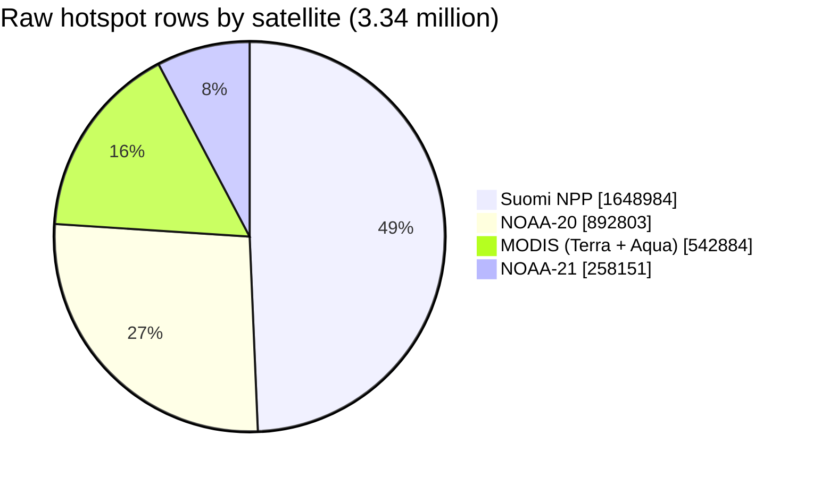
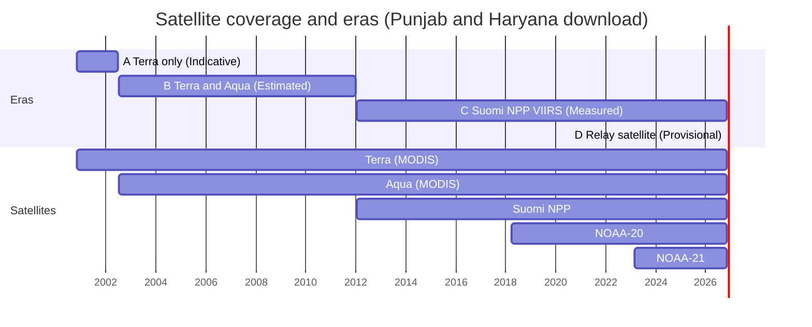
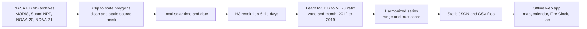
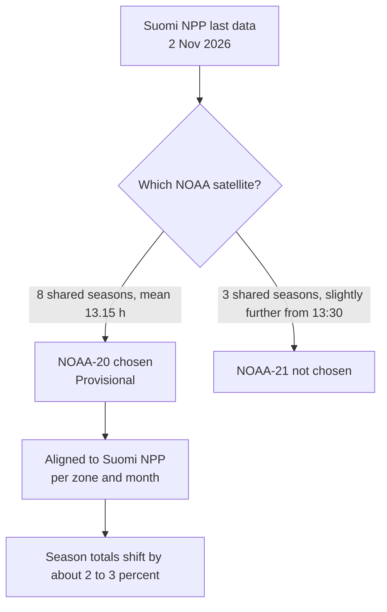

# EMBERWISE

**One harmonized MODIS–VIIRS fire record for Punjab and Haryana, with a Fire Clock that shows when each satellite looked.**

*Giving every satellite fire count a clock, so 26 years of MODIS and VIIRS records can be read together and the drift and handovers stay visible.*

   -lightgrey)  

NASA Space Apps Challenge 2026 · Challenge 9: Harmonization of MODIS and VIIRS Hot Spots

> **EMBERWISE provides a relative burning activity index for research and historical analysis. It is NOT an official real-time fire alert, fire perimeter map, or emergency response tool.** A hotspot is a thermal detection, not a confirmed fire. No hotspot does not mean no fire.

**Code repository:** https://github.com/sudiksha8639-debug/ThermoWeave

**Live app, backup video and slides:** links are added to the submission form and to this page when deployment finishes (deployment follows the 15:00 code freeze on 15 Nov 2026).

---

## At a glance

| | |
|---|---|
| Record length | Nov 2000 to Nov 2026 (about 26 years) |
| Satellites | 5: Terra, Aqua (MODIS) and Suomi NPP, NOAA-20, NOAA-21 (VIIRS) |
| Hotspot rows processed | 3,342,822 raw rows in the Punjab and Haryana download box |
| Study area | Punjab and Haryana, India (clipped to state boundaries) |
| Counting unit | H3 resolution-6 tile-day (about 36 km²) |
| Handover | Suomi NPP (stopped 2 Nov 2026) to NOAA-20, Provisional |
| Stack | Python pipeline, static JSON, React and TypeScript, no backend |



## What it does

**Explore**
- **Area picker and date range.** Three presets (Indian Punjab, Haryana, Punjab + Haryana) plus a lat/long box inside the loaded regions.
- **Year-by-month calendar** with a plain hotspot-count view beside the harmonized view.
- **Harmonized series** with a range ribbon, with the raw MODIS and VIIRS lines kept visible.
- **Hex map** of burning tile-days (Canvas, H3 tiles), with click-to-inspect.
- **Sensor-mode switch:** MODIS, VIIRS, naive splice or harmonized.
- **This-month card** comparing the month with the same month in other years, with a fair rule for a month still in progress (presets only).
- **Local Normal badge, critical periods and a plain-language sentence** describing what the data show.
- **Era banner and trust score** (0 to 100 per tile-month) so every number says how much to trust it.

**See the problem and the proof**
- **Phantom Surge:** the naive MODIS-to-VIIRS splice shown next to the harmonized line, so the 2012 jump is visible.
- **Fire Clock Dial and drift chart:** when each satellite looked, and how Terra and Aqua drifted.
- **Relay timeline and Sensor-Loss toggle:** drop Suomi NPP on the current season and see the percent shift when NOAA-20 takes over.
- **Transparency Lab:** hide-a-year test, baselines, seam check, ratio stability, resolution 5/6/7 sensitivity, saturation flag (fraction of tiles burning shown beside tile-days), and weak-zone panels. Failures are shown with a caveat.

**Take it with you**
- **CSV downloads:** monthly tile rows and raw hotspot files per preset and year (day and night, local solar date).
- **Shareable permalink**, **offline installable PWA**, text-table alternatives to charts, a colour-safe palette and keyboard access.
- **Methods, How to read, Limits and Provenance pages**, and a safety disclaimer on every screen.

## 1. Why this exists

MODIS (2000 to present, 1 km pixels) and VIIRS (2012 to present, 375 m pixels) see the same fires with different pixel sizes and different overpass times. Joining their raw counts end to end creates a jump around 2012 that looks like a fire surge but is a satellite upgrade. We call this the **Phantom Surge**.

Suomi NPP also stopped delivering on 2 Nov 2026 (the last row in our data is dated 2 Nov 2026), and MODIS is scheduled to retire in 2027, so the record needs a handover to another satellite. EMBERWISE builds one continuous record and shows its uncertainty openly.

## 2. Three rules

1. Never add MODIS and VIIRS counts. They see the same fires.
2. One source of truth per day.
3. Label every number: Measured, Estimated, Indicative or Provisional.

## 3. How the record is built

- **Counting unit.** A burning tile-day is one H3 resolution-6 tile (about 36 km²) with at least one clean hotspot on one local solar date.
- **Eras.**
  - A: Nov 2000 to Jun 2002, Terra only (Indicative).
  - B: Jul 2002 to Dec 2011, Terra ∪ Aqua (Estimated).
  - C: Jan 2012 (partial, from 20 Jan) to 2 Nov 2026, Suomi NPP VIIRS (Measured).
  - D: from 3 Nov 2026, relay satellite (Measured; latest months Provisional).
- **Conversion.** MODIS tile-days are converted to the VIIRS scale with ratios learned per zone (H3 res 3) and calendar month on 2012 to 2019, before Terra and Aqua drifted. Harmonized = MODIS tile-days × ratio, capped at the number of in-scope tiles. The range shown is the 10th to 90th percentile of yearly ratios, not a confidence interval.
- **Relay.** From 3 Nov 2026 a NOAA satellite is aligned to Suomi NPP over shared seasons (see findings).
- **Local solar time.** `local_hours = UTC hours + longitude / 15`; `local_date = UTC date + floor(local_hours / 24)`. All dates in the app and CSVs are local solar dates.
- **Scope.** Punjab and Haryana clipped to state boundary polygons; a tile is in scope if its centroid is inside.

### Timeline of satellites and eras



### From raw data to the app



### Architecture and stack

- **No backend.** Heavy work runs once in Python and writes small pre-aggregated JSON files (chart data budget under 8 MB per region). The site only reads those files and works offline after first load.
- **Frontend.** Vite, React, TypeScript, Tailwind; d3 scales and hand-written SVG; Canvas hex map using a precomputed tile-geometry file; installable PWA.
- **Spatial unit.** H3 resolution 6 tiles remove pixel-size differences between MODIS and VIIRS. Resolutions 5 and 7 are used for sensitivity checks.
- **Uncertainty.** The range on the harmonized line is the 10th to 90th percentile of yearly ratios. A split-conformal interval is a stretch item and is not claimed.
- **Secrets.** The FIRMS MAP_KEY is used only in offline build scripts through environment variables and never appears in website code.

## 4. The Fire Clock Dial: a diagnostic, not a correction

The dial shows the local hour at which each satellite looked. It does **not** change the headline number. The headline index uses VIIRS directly from 2012 and, before 2012, MODIS converted with ratios learned on 2012 to 2019, so later Terra and Aqua drift never enters it. The dial exists so anyone can see the drift and judge the limits. Satellites only look at these times; the dial shows when we looked, not the full daily fire cycle.

## 5. Key findings

**Orbit drift (data).** Terra and Aqua held their local viewing times through about 2021, then shifted. Terra's median local hour falls from about 10.9 to about 9.25 by 2026; Aqua's rises from about 13.3 to about 15.3; the VIIRS satellites stay near 13.1 to 13.3. MODIS after about 2022 therefore cannot be compared with earlier MODIS. The VIIRS/MODIS ratio for Punjab + Haryana in Oct to Nov falls from about 2.53 in 2012 to about 1.43 in 2025, and Terra's Oct to Nov tile-days fall from about 1,200 in 2012 to about 16 in 2025. We show this and do not state a cause.

| Satellite | Median local hour, early years | Median local hour, 2026 |
|---|---|---|
| Terra (MODIS) | about 10.9 | about 9.25 (earlier) |
| Aqua (MODIS) | about 13.3 | about 15.3 (later) |
| Suomi NPP, NOAA-20, NOAA-21 (VIIRS) | about 13.1 to 13.3 | about 13.1 to 13.3 (steady) |

**Handover to NOAA-20.**

- NOAA-20 is the relay, marked Provisional. It looks at about 13:09 local time on average (13.15 h) against a 13:30 target. NOAA-21 is only about a minute and a half further off, so the choice is close. NOAA-20 has 8 shared seasons with Suomi NPP; NOAA-21 has 3.
- Pretending Suomi NPP stopped and rebuilding a season from NOAA-20 alone: the 2025 season came out about 2 to 3% above what Suomi NPP saw, with day-by-day agreement of 0.986 (pass mark 0.85). The 2021 season, held out, came out about 3% below, but day-by-day agreement was 0.81, under the pass mark. Season totals are sound; single days are looser.
- Switching to NOAA-20 changes a season's total by about 2 to 3%.



**Peak-season overshoot.** In Indian Punjab, on the 85 busiest days of 2012 to 2019, the straight ratio is off by about 61% per day and overpredicts. It even predicts more tiles burning than exist (1.47 against a limit of 1), which is why the index is capped. A curved alternative does better (about 40% error) but underpredicts. Peak days before 2012 are therefore upper-end estimates. Haryana and the combined region never pass the half-the-tiles mark in those years.

**NRT versus standard seam.** Untested. For all three VIIRS satellites standard data ends 31 Jul 2026 and near-real-time data starts 1 Aug 2026 (MODIS: 30 Aug and 3 Sep), so no month has both versions for the same satellite. Near-real-time files also have no `type` column, so a static-source mask built from standard-data history is applied to all eras. The whole Aug to Nov 2026 season is near-real-time and Provisional.

## 6. Validation

| Check | Result or where it is reported |
|---|---|
| Relay test (drop Suomi NPP, rebuild from NOAA-20) | Season totals within about 2 to 3%; 2025 daily match 0.986 (pass); 2021 held out 0.81 (below the 0.85 pass mark) |
| Peak-day overshoot | Straight ratio off by about 61% per day on the 85 busiest days; index capped at the in-scope tile count |
| NRT seam check | Pending: no overlapping months in the downloaded data |
| Orbit drift | Measured in `drift.json` and shown on the Fire Clock Dial |
| Hide-a-year, baselines, rank test, 2012 seam check, ratio stability, resolution sensitivity, era-B test, negative control | Defined in the build plan; results are shown on the app's Proof screen and in `docs/MODEL_CARD.md` |

Failures are shown in the app with a caveat. A visible weakness scores better than a hidden one.

## 7. Known limits

- A MODIS-to-VIIRS relationship learned after 2012 is applied to years before 2012; this cannot be fully tested.
- Behaviour confound: burning in the region has shifted later in the day, and Terra (about 10:30) sees less afternoon burning than VIIRS (about 13:30). A learned ratio may partly reflect habit rather than sensor difference.
- Saturation: at the peak many tiles burn, so tile-days flatten. Use the fraction of tiles burning and the raw hotspot view together.
- The index is relative activity, not fire size, burned area or total fires.
- Era A (Terra only) is the least certain.
- 2026 is partial. Suomi NPP's last data is 2 Nov 2026; NOAA-20, NOAA-21 and MODIS near-real-time files stop on 5 Nov 2026, and no refresh for 6 to 14 Nov was made.
- Jan 2012 is partial (Suomi NPP starts 20 Jan 2012).
- Days with no rows can mean no fire or no data. Gaps are shown as gaps, not zeros. Suomi NPP has no rows on 2024-11-03 to 05 and 2025-10-06 while NOAA-20 does, which look like possible outages (cause not confirmed).
- The relay choice is Provisional, and the NOAA-20 versus NOAA-21 choice is close.
- Only one control download (Suomi NPP) exists; the other three were not made.

## 8. Data

**Source.** NASA FIRMS active-fire data (MODIS Collection 6.1; VIIRS Collection 2 for Suomi NPP, NOAA-20 and NOAA-21), requested 13 to 14 Nov 2026 under request IDs 845475, 845493, 845498, 845518 and 846801. Citation: NASA FIRMS, Fire Information for Resource Management System, NASA EOSDIS / LANCE, https://firms.modaps.eosdis.nasa.gov. This project is not endorsed by NASA and uses no NASA logos.

**Area.** Main download box: west 73.5, south 27.4, east 78, north 32.8 (degrees), clipped to Punjab and Haryana state boundaries. Control box: west 76, south 31, east 79.5, north 33.5, clipped to the Lahul and Spiti district.

**Boundaries.** Survey of India state boundary file (reprojected from EPSG:7755 to lat/lon, simplified to about 200 m); Lahul and Spiti from the district file. Originals are not committed. Source and licence terms: `docs/DATA_SOURCES.md`.

**Files in the repo.**

| File | Contents |
|---|---|
| `mock-data/hourly.json` | Hotspot counts by region, satellite, year, month, local hour |
| `mock-data/drift.json` | Median local hour and IQR per satellite, year, region; VIIRS/MODIS ratio for Oct to Nov |
| `mock-data/hotspots_indian_punjab_<year>.csv`, `hotspots_haryana_<year>.csv` | Raw hotspot rows, 2020 to 2026, day and night |
| `docs/RAW_FILES.csv` | Every raw file: request ID, rows, dates, SHA-256 |
| `docs/ROW_AUDIT.csv` | Raw rows versus rows kept after cleaning |
| `docs/manifest.json` | Machine-readable manifest: raw downloads, SHA-256 hashes, processing parameters, boundary source, AI-use note |

CSV header: `satellite,date,time_utc,local_solar_time,lat,lon,frp,confidence,day_night,product`. The Punjab + Haryana download joins the two files in the browser. 2019 was dropped to stay under the 60 MB budget (total 54.5 MB, largest file 10.7 MB).

Large Parquet files (`tile_day`, `tiles`, `nrt_sp_pairs`) and the raw FIRMS CSVs are git-ignored; the Parquet files are shared by team Drive. Full provenance, cleaning rules and findings are in `docs/DATA_LOG.md`.

## 9. Run it

Python packages: `polars` plus the packages imported at the top of each script in `pipeline/`. Set `FIRMS_MAP_KEY` as an environment variable only if you re-download raw data. A Makefile (`make data`) is planned; until then run the scripts directly from the repo root:

```
python pipeline\log_raw_files.py        # hashes, row counts, row audit
python pipeline\make_manifest.py        # docs/manifest.json from the two files above
python pipeline\ingest.py               # raw CSVs to hotspots_clean.parquet
python pipeline\tiles.py                # H3 tile-days and tiles
python pipeline\export_contract.py      # contract files for the analysis stage
python pipeline\export_web_data.py      # hourly.json, drift.json, hotspot CSVs
python pipeline\nrt_sp_pairs.py         # SP/NRT pairs (0 overlap rows)

cd web
npm install
npm run dev
```

`export_web_data.py` accepts optional `YEARS` and `PRESETS` environment variables to limit the CSVs it writes.

## 10. Repository layout

```
pipeline/   ingest, boundary, normalize, tiles, export and data-check scripts
data/       raw and processed (git-ignored, hashed in docs/RAW_FILES.csv)
mock-data/  small derived files copied into the site by its sync script
web/        story, workspace, proof (Vite, React, TypeScript, Tailwind)
docs/       METHODS.md, MODEL_CARD.md, DATA_SOURCES.md, DATA_LOG.md, RAW_FILES.csv, ROW_AUDIT.csv
```

## 11. Team

Six members: M1 data pipeline, M2 harmonization, M3 analytics, M4 frontend, M5 visualization, M6 product and QA. Names are on the submission form.

## 12. Credits and references

- NASA FIRMS / LANCE for the active-fire data.
- Giglio, L., Schroeder, W., Justice, C.O. (2016). The Collection 6 MODIS active fire detection algorithm and fire products. Remote Sensing of Environment, 178, 31–41.
- Schroeder, W., Oliva, P., Giglio, L., Csiszar, I.A. (2014). The New VIIRS 375 m active fire detection data product: Algorithm description and initial assessment. Remote Sensing of Environment, 143, 85–96.
- Boundary data: Survey of India state boundaries, as supplied by the team (terms in `docs/DATA_SOURCES.md`).

## 13. Event rules and pre-kickoff work

Before kickoff (10 to 13 Nov) the team did research only: reading the challenge and FIRMS documentation, requesting the FIRMS key, requesting raw data archives, choosing the boundary source and planning the design on paper. The raw FIRMS archives were requested on 13 to 14 Nov (timestamps in `docs/RAW_FILES.csv`). All application code, pipeline code and derived data files in this repository were written during the event window (14 to 15 Nov 2026).

## 14. AI-tools disclosure

AI assistants (Claude, by Anthropic) were used by team members for code assistance, debugging, checking analysis and drafting documentation. Team members ran the code, checked the results and are responsible for all outputs in this repository.

## 15. Licence

See `LICENSE` in the repository root. Data remain subject to NASA FIRMS terms.